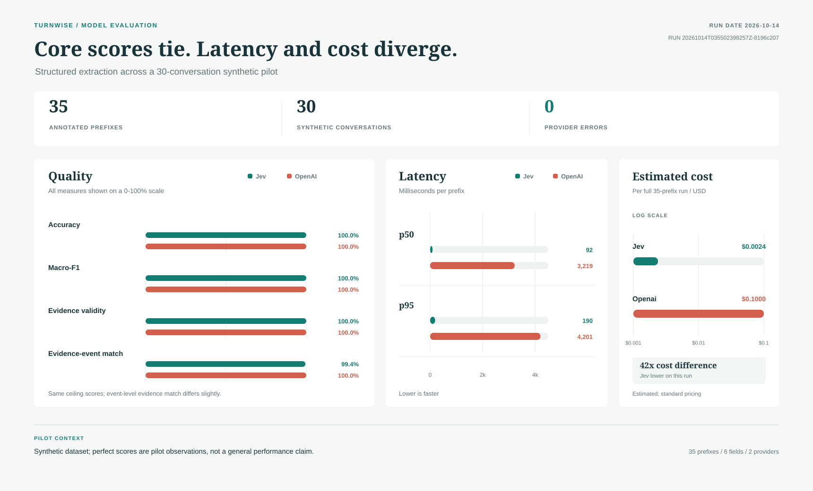

# Turnwise


*From conversation to structured decisions.*

Turnwise is a research project about extracting reliable, reviewable information from conversations. It compares a decision model with schema-constrained LLMs and will investigate whether training an open-weight classifier for the task improves on those baselines.

**Status: Early implementation.** The uv-managed package, CLI, reviewed synthetic pilot dataset, offline validator, replay pipeline, Jev/OpenAI adapters, evaluation runner, and first comparison are implemented. Results remain exploratory pilot evidence, not a general performance claim.

## Problem

A household repair intake conversation should become a structured form that updates as new information arrives. For example, the system should record that a washing machine leak has stopped, replace a Friday appointment preference with Saturday afternoon when the speaker corrects it, and note that a quote is required before work begins.

The initial experiment uses synthetic English conversations about one appliance, two known speaker roles, and approximately two to five minutes of audio. Turnwise drafts information for human review; it does not book services or authorize spending.

## Research approach

The first comparison is between Jev and a general LLM using schema-constrained output. Both receive the same task labels, transcript prefixes, and candidate values. The next modeling objective is to train an open-weight classifier and measure whether task-specific training improves its results against both references. A smaller hosted LLM baseline is deferred future work. The experiment measures correctness, output validity, latency, cost, and uncertainty handling; valid output structure alone is not treated as evidence of correct answers.

The open-weight training roadmap, data and review process, and training workflow are documented in the [training plan](docs/training/plan.md). Durable research and implementation choices will be recorded in `docs/decisions/`; the [project plan](docs/project-plan.md) remains the overview of the full research roadmap.

The task and experimental limits matter: matching Jev on this defined task would not show equivalent performance on arbitrary tasks. See the [evaluation protocol](docs/evaluation-protocol.md) for the planned comparison and metrics.

## Project documents

- [Project plan](docs/project-plan.md): milestones, architecture, tooling, and intended repository layout.
- [Annotation guide](docs/annotation-guide.md): field meanings and rules for evidence, unknowns, negation, and corrections.
- [Evaluation protocol](docs/evaluation-protocol.md): baselines, data splits, metrics, and comparison safeguards.

## Command-line interface

Install [uv](https://docs.astral.sh/uv/), then install the project and its dependencies from the repository root:

```bash
uv sync
uv run turnwise --help
uv run pytest
```

GitHub Actions runs the dataset validator and test suite on pushes and pull requests. CI uses no provider credentials and makes no hosted API calls.

The CLI registers four commands. Offline dataset validation, replay, pilot evaluation, and report summaries are implemented. Hosted replay and benchmark commands make paid API requests; select them explicitly. Use each command's `--help` option to inspect its arguments:

```bash
uv run turnwise validate --help
uv run turnwise replay --help
uv run turnwise benchmark --help
uv run turnwise report --help
```

| Command | Arguments |
| --- | --- |
| `validate` | `--dataset PATH` (defaults to `data/examples`) |
| `replay` | `--case PATH`, `--provider fixture|jev|openai`; fixture-only `--responses PATH` |
| `benchmark` | `--config PATH` |
| `report` | `--run PATH` |

Run a bounded smoke comparison or the full 30-case, 35-prefix pilot after all annotations are reviewed:

```bash
uv run turnwise benchmark --config configs/experiments/jev-vs-llm.yaml --max-prefixes 2
uv run turnwise benchmark --config configs/experiments/jev-vs-llm.yaml
uv run turnwise report --run runs/<run-id>
```

The benchmark invokes Jev and OpenAI sequentially for every selected gold prefix, saves predictions and evaluator-only gold comparisons under `runs/<run-id>/evaluation.json`, and never supplies annotations to providers. The expanded corpus has 30 synthetic conversations and 35 selected prefixes; results are still pilot evidence, not a representative performance claim. The report includes accuracy, per-field macro-F1, evidence validity, p50/p95 request latency, input/output token totals, refusals, errors, and an estimated USD cost.

### Latest pilot results



The [sanitized aggregate summary](reports/jev-vs-llm-pilot-20261014.json) records run `20261014T035502398257Z-8196c207` without persisting per-prefix predictions or gold values. Both providers scored 100% on accuracy, macro-F1, and evidence validity. Evidence-event match was 99.4% for Jev and 100% for OpenAI. Jev's p50 latency was 92 ms versus 3,219 ms for OpenAI; estimated run cost was $0.0024 versus $0.1000. These are pilot observations on synthetic data, not a representative performance claim.

Evidence-event match counts a known value as matched only when the cited event overlaps the single event recorded in the gold annotation. Jev's one miss (1 of 180 known values) was `repair-005-s02`, `preferred_appointment`: the value was correct, and Jev cited the customer's original statement (`repair-005-e03`) rather than the later reaffirmation the annotation records (`repair-005-e07`). Both are valid customer evidence for the value, so this reflects the strict single-event gold rather than a Jev error. This was found by inspecting the ignored raw run, which the committed summary cannot reproduce.

Regenerate the figure from the committed summary without requiring the ignored raw run artifact:

```bash
uv run python scripts/plot_pilot_results.py \
  --summary reports/jev-vs-llm-pilot-20261014.json \
  --output reports/jev-vs-llm-pilot-20261014.svg
```

Cost is estimated from SDK-reported tokens and standard short-context rates pinned in the experiment config: Jev input is `$0.042` per million tokens with free output; OpenAI `gpt-6.1-sol` input is `$2.00`, cached input `$0.10`, cache writes `$2.50`, and output `$10.00` per million tokens. The estimate is marked incomplete when usage is missing; taxes, account discounts, and any non-standard processing tier are excluded. See the pricing sources recorded in the config.

The full expanded pilot contains 35 annotated prefixes and invokes two providers per prefix: up to 70 hosted requests before SDK retries. Use `--max-prefixes 1` or `2` to bound a smoke run. The command is explicit; ordinary `uv run pytest` and `turnwise validate` do not make hosted calls.

Hosted evaluation requires every gold case to be human-approved. The manifest records all 30 cases and 35 snapshots as approved, along with reviewer metadata. The runner verifies the manifest and source hashes before constructing providers.

### Jev request

The Jev adapter uses TypeSafe's **System One decision API**, not text generation. It sends the current transcript prefix and shared candidates as `state`, then asks typed `Choice` questions. Candidate-backed fields select a candidate ID. Boolean fields select a value and supporting customer event together, so Jev cannot return a known boolean with unknown evidence.

The request shape is:

```python
from typesafe_sdk import Choice, TypeSafeClient

with TypeSafeClient(api_key=settings.typesafe_api_key, model="jev-1.13.0") as client:
  response = client.system_one(
    state={
      "conversation_id": decision_input.conversation_id,
      "task_id": decision_input.task_id,
      "task_version": decision_input.task_version,
      "transcript_prefix": [
        {"event_id": event.event_id, "speaker": event.speaker, "text": event.text}
        for event in decision_input.transcript
      ],
      "candidates": [
        {"candidate_id": item.candidate_id, "field_id": item.field_id, "text": item.text}
        for item in decision_input.candidates
      ],
    },
    questions={
      "value__appliance": Choice(
        instructions="Select the candidate that answers the appliance field. Select __unknown__ if none does.",
        criteria={candidate_id: candidate_text, "__unknown__": "No supported appliance."},
      ),
      "value__active_leak": Choice(
        instructions="Choose true or false together with the customer event that supports it; otherwise choose __unknown__.",
        criteria={
          "true::event-id": "The leak is active now. Supporting customer statement: ...",
          "false::event-id": "The leak has stopped. Supporting customer statement: ...",
          "__unknown__": "The current leak state is unknown.",
        },
      ),
    },
    model="jev-1.13.0",
  )
```

The adapter builds corresponding questions for all six fields. For a selected candidate, code copies the candidate's original source span and normalizes it; the model does not generate the final date, location, appliance string, or amount.

### GPT-6.1 Sol prompt

OpenAI uses the Responses API in **strict JSON Schema mode**. The schema is constructed from the task definition and the candidate IDs/events visible in that prefix. The exact `instructions` text sent by the adapter is:

```text
Extract the current repair-intake form from only the supplied transcript prefix. Use only customer statements as evidence; an intake-agent question is not evidence. For candidate-backed fields, choose a supplied candidate ID or null; do not invent a value; the candidate itself provides its evidence span. For active_leak and quote_required return true, false, or __unknown__, and return a customer event ID supporting each known boolean value. Use null evidence for unknowns. Do not use events after the supplied prefix.

Fields:
- appliance: The single appliance for which service is requested. True: not applicable False: not applicable Unknown: No appliance is identified clearly.
- location: Where the appliance or reported problem is located. True: not applicable False: not applicable Unknown: No location is stated clearly.
- active_leak: Whether water is leaking at the latest point in the visible conversation. True: The customer explicitly indicates the leak is active now. False: The customer explicitly indicates the leak has stopped or is not active now. Unknown: The current status is unstated, ambiguous, or conflicting.
- preferred_appointment: The customer's latest explicit appointment preference. True: not applicable False: not applicable Unknown: No appointment preference is stated.
- quote_required: Whether the customer requires a quote before work begins. True: The customer explicitly requests a quote before work. False: The customer explicitly says a quote is not required. Unknown: The quote requirement is not stated or is ambiguous.
- spending_limit: Explicit maximum amount the customer is willing to spend. True: not applicable False: not applicable Unknown: No spending maximum is stated; do not infer it from a requested quote.
```

The request uses `model="gpt-6.1-sol"`, `reasoning.effort="low"`, `store=False`, and `text.format={"type":"json_schema","strict":true,...}`. Candidate selections and boolean evidence are then validated and normalized locally.

### Future work

The current pilot compares Jev with GPT-6.1 Sol. The primary next research step is to select an open-weight model, establish a pretrained classifier baseline, then train it for repair-intake classification and compare both against the same frozen task and leakage-safe evaluation. A smaller, lower-cost hosted model such as GPT-6 Luna is deferred and is not required for that next milestone. Broader claims require additional data and a held-out evaluation set.

Validate the conversation and annotation files in the example dataset with:

```bash
uv run turnwise validate --dataset data/examples
```

Validation checks task/version consistency, conversation/annotation pairing, event ordering and speaker roles, complete field maps, prefix ordering, and evidence references and spans. Invalid data is reported with file paths and causes a nonzero exit status.

Replay evaluates each transcript prefix in event order. The fixture provider is a deterministic offline test double; it does not infer values. Supply a separate response script to exercise form updates and corrections:

```bash
uv run turnwise replay \
  --case data/examples/conversations/repair-004-corrections.json \
  --provider fixture \
  --responses data/examples/provider-responses/repair-004-corrections.json
```

Without `--responses`, the fixture provider makes no field updates. Each run writes snapshots and metadata to a unique `runs/<run-id>/replay.json`; transcript text and gold annotations are not copied into the artifact. Scripted provider responses are for pipeline checks only, not benchmark predictions or evidence of model quality.

Hosted provider replay requires the corresponding key in `.env` and performs one request per transcript event prefix:

```bash
uv run turnwise replay --case data/examples/conversations/repair-001-ordinary.json --provider jev
uv run turnwise replay --case data/examples/conversations/repair-001-ordinary.json --provider openai
```

The defaults match the pilot pins: Jev `jev-1.13.0` and OpenAI `gpt-6.1-sol`. Override them with `JEV_MODEL` or `OPENAI_MODEL` when deliberately changing the experiment.

## Provider credentials

Copy `.env.example` to `.env` and add the credentials you use. `.env` is ignored by Git. Settings load `.env` without overriding variables already present in the process environment; secret values are excluded from settings representations.

```bash
cp .env.example .env
```

`TYPESAFE_API_KEY` is used for Jev and `OPENAI_API_KEY` for OpenAI. Both provider SDK versions are pinned in `pyproject.toml`. Credentials are checked only when configuration for that provider is requested.

The settings API returns the selected model and credential for a provider without exposing the key in object representations:

```python
from turnwise.settings import Settings

settings = Settings.load()
jev = settings.for_provider("jev")
openai = settings.for_provider("openai")
```

## Repository structure

This is the current scaffold. Empty directories are retained with `.gitkeep`; implementation files will be added as the milestones progress. The local `.venv/` is excluded from version control.

```text
turnwise/
├── configs/
│   ├── experiments/
│   │   └── jev-vs-llm.yaml
│   └── tasks/
│       └── repair-intake.yaml
├── data/
│   ├── examples/
│   │   │   └── repair-001..repair-030 gold files
│   │   ├── conversations/
│   │   │   └── repair-001..repair-030 transcript files
│   │   └── provider-responses/
│   │       └── repair-004-corrections.json
│   └── manifests/
│       └── jev-vs-llm-pilot.json
├── docs/
│   ├── decisions/
│   ├── annotation-guide.md
│   ├── evaluation-protocol.md
│   └── project-plan.md
├── src/turnwise/
│   ├── app/
│   ├── audio/
│   ├── evaluation/
│   │   └── runner.py
│   ├── pipeline/
│   │   ├── __init__.py
│   │   ├── candidates.py
│   │   ├── normalization.py
│   │   ├── prefix.py
│   │   └── replay.py
│   ├── providers/
│   │   ├── __init__.py
│   │   ├── base.py
│   │   ├── fixture.py
│   │   ├── jev.py
│   │   ├── structured_llm.py
│   │   └── task.py
│   ├── training/
│   ├── __init__.py
│   ├── cli.py
│   ├── contracts.py
│   └── settings.py
├── tests/
│   ├── integration/
│   └── unit/
│       ├── test_candidate_extraction.py
│       ├── test_dataset_validation.py
│       ├── test_experiment_config.py
│       ├── test_evaluation_runner.py
│       ├── test_prefix_assembly.py
│       ├── test_provider_adapters.py
│       ├── test_replay.py
│       ├── test_settings.py
│       ├── test_synthetic_conversations.py
│       └── test_task_definition.py
├── checkpoints/
├── reports/
├── runs/
├── .env.example
├── .gitignore
├── pyproject.toml
├── README.md
└── uv.lock
```

## References

- [TypeSafe and Jev documentation](https://docs.typesafe.ai/introduction)
- [Train your own decision model with Unsloth](https://unsloth.ai/docs/basics/train-your-own-decision-model-with-unsloth)
- [TypeSafe candidate-based value extraction](https://docs.typesafe.ai/cookbooks/pre_parsed_value_extraction_cookbook)

---
Made with 🩶 by Cortio and Copilot 